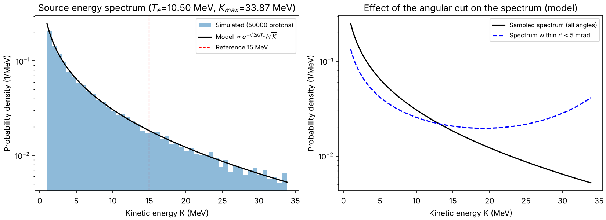
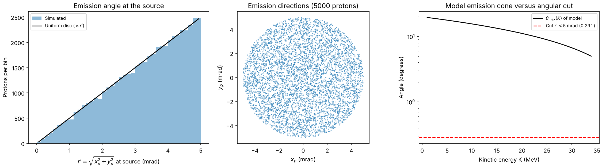
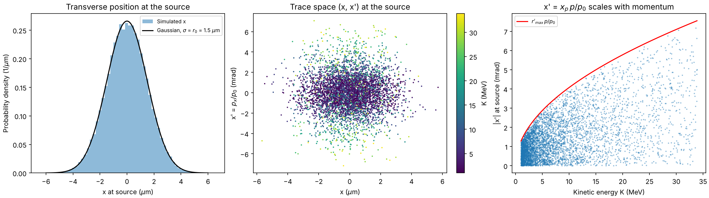
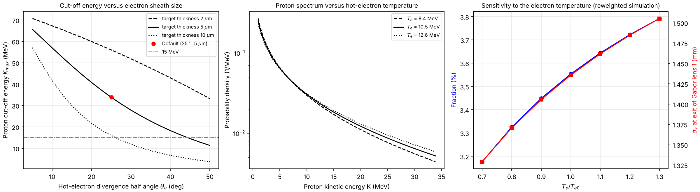
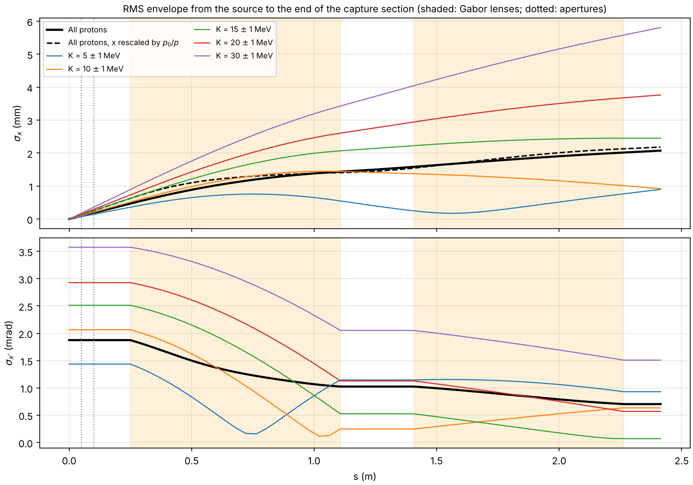
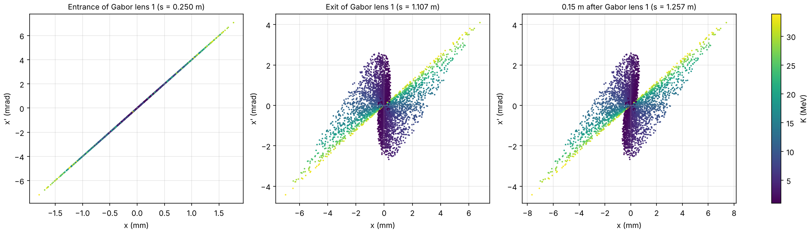
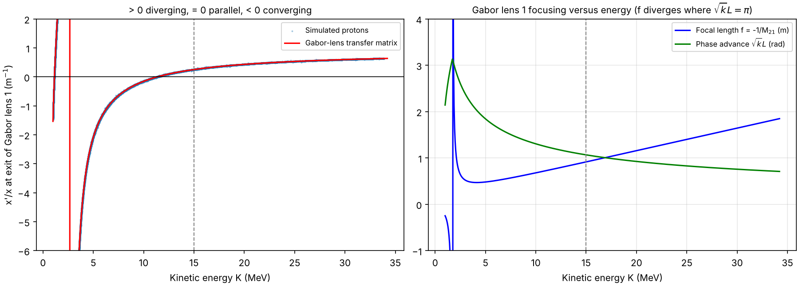
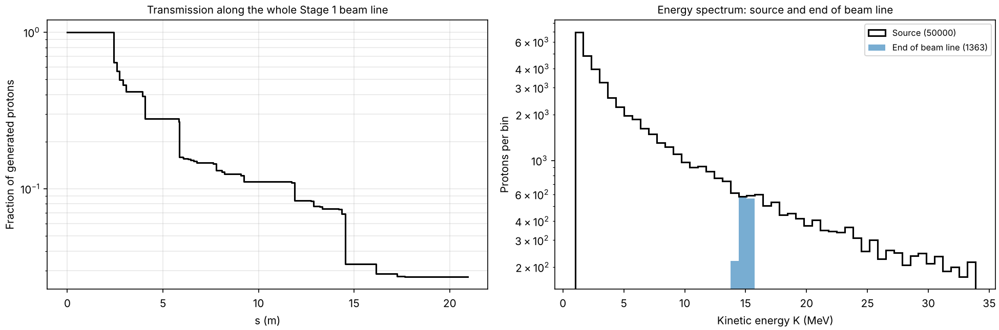
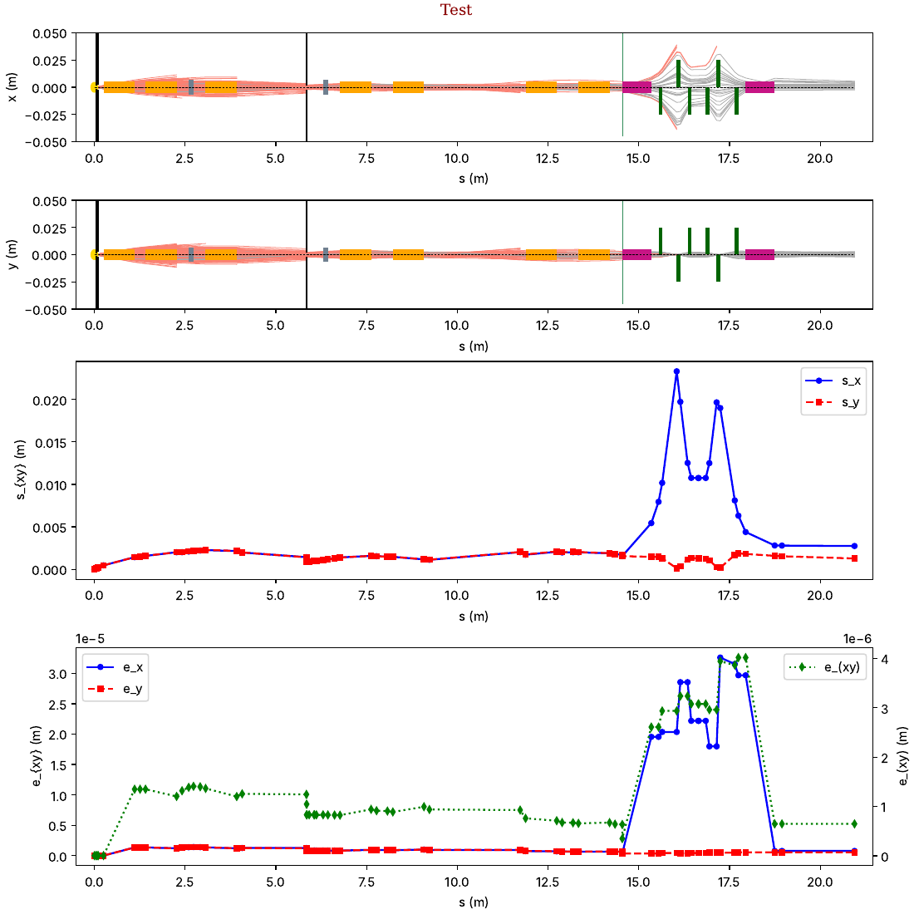
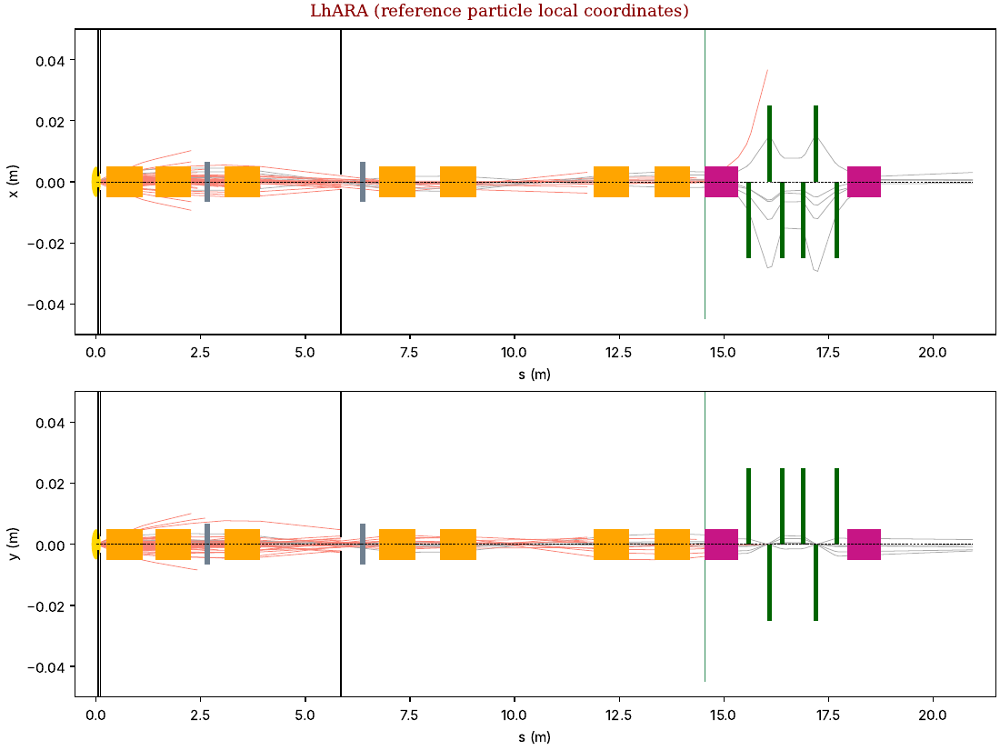

# LhARA 第一阶段束线模拟报告：激光驱动质子源与第一个 Gabor 透镜

| 项目 | 内容 |
|---|---|
| 日期 | 2026-10-26 |
| 代码 | `LhARAlinearOptics`，分支 `claude/busy-euler-mjur5i` |
| 束线配置 | `11-Parameters/LhARABeamLine-Params-LsrDrvn-Gabor.csv`（TNSA 激光源 + Gabor 透镜，第一阶段主配置，未做任何修改） |
| 事件数 | 50 000 个质子，固定随机种子 20261026（可完全复现） |
| 运行时间 | 模拟 303 s；官方包络脚本 `plotBeam.py` 44 s；本报告的分析脚本约 4 min |
| 分析脚本 | 本目录下的 `sourceGL1Analysis.py`（复现方法见第 8 节） |

> 英文版见 `report-EN.md`。图中文字统一用英文，便于两份报告共用。

---

## 摘要

1. **激光质子源**：代码默认激光参数为 10 J、40 fs（250 TW），焦斑半径 1.5 µm，光强 2.1×10²¹ W/cm²。由 TNSA 模型算出热电子温度 Te = 10.5 MeV，质子截止能量 Kmax = 33.9 MeV。生成的能谱近似指数下降：中位数 5.4 MeV，平均 8.4 MeV，落在 14–16 MeV（参考能量 15 MeV 附近）的只有 3.55%。源的横向尺寸 σ = 1.5 µm，发射方向被参数 `rpmax` 限制在 r′ < 5 mrad 以内，RMS 几何发射度为 2.8×10⁻³ mm·mrad。
2. **源模型的两个隐含假设**：
   - `rpmax` 只保留了 TNSA 发射锥中约 **0.08%** 的质子，所以所有“传输效率”都是相对这个小角度子集而言的。
   - 能量是按全角度积分的能谱抽样的，而真实 5 mrad 锥内高能质子占比更高，所以模拟能谱偏“软”。
3. **源 → 第一个 Gabor 透镜（GL1）入口**（s = 0.25 m）：两道喷嘴光阑（半径 2.0 mm、2.87 mm）对这个 5 mrad 的束流完全透明，传输率 **100%**。GL1 入口处的物理 RMS 束斑为 0.63 mm。
4. **GL1**：长 0.857 m，电子密度 n_e = 5.1×10¹⁵ m⁻³，等效磁场 B₀ = 1.40 T。
   - 对 15 MeV 质子：k = 1.55 m⁻²，相移 1.07 rad，等效焦距 0.92 m。
   - GL1 把全束的 RMS 发散度从 1.88 mrad 降到 1.03 mrad，但 15 MeV 质子出射后仍略发散（x′/x = +0.26 m⁻¹，相当于虚源位于出口上游 3.9 m）。只有约 **11.3 MeV** 的质子被变成平行束。这与设计一致：俘获段由两个 Gabor 透镜共同完成。
5. **强色差**：聚焦强度 k ∝ γ/p²，所以低于 11.3 MeV 的质子被过聚焦（汇聚），低于约 2.7 MeV 的在透镜内部就越过了轴线。
   - 全束的投影 RMS 发射度从 0.0028 增大到 1.35 mm·mrad（**约 480 倍**）。
   - 在 ±0.25 MeV 的窄能带内只增大 4–23 倍；对单一能量，线性透镜严格保持发射度。所以发射度增长几乎完全来自宽能谱造成的色差。
6. **源处电子**（按代码使用的模型计算）：
   - 热电子温度 10.5 MeV（小焦斑修正使其低于纯有质动力定标的 15.6 MeV），数目约 1.8×10¹²。
   - 靶背鞘层半径 3.8 µm，密度 3.2×10²⁷ m⁻³（约 1.9 倍临界密度），鞘层电场约 2.5×10¹³ V/m，德拜长度 0.42 µm。
   - 用 Mora 等温膨胀模型独立估算，Kmax = 24–35 MeV，与代码的 33.9 MeV 一致。
7. **能否用电子诊断质子源分布？部分可行。**
   - 在模型里，质子能谱的形状由 Te 决定，截止能量由“激光→电子能量转换效率”和电子鞘层大小（电子发散角、靶厚）共同决定。所以测出电子的温度和鞘层大小，可以约束质子能谱。
   - 但这种约束依赖模型，而且精度要求很高：Kmax 对电子发散角的敏感度约为 −1.3 MeV/度，要把 Kmax 预测到 ±1 MeV，发散角必须测到 ±0.8° 以内。
   - 质子的角分布和相空间细节无法从电子推出。
   - 建议的用法是：把电子测量作为逐发（shot-to-shot）监测手段，再用直接的质子测量标定。
8. **影响结果解读的两个代码层面发现**：
   - 远离 15 MeV 的质子，代码给出的横向位置被缩放了 p/p₀（第 4.3 节）。
   - 整条束线上 91% 的“损失”来自代码的纵向截断（|z| > 5 m），而不是准直器（第 5 节）。

---

## 1. 模拟设置

- **束线**：主配置文件，不改任何参数。源为 `SourceMode = 0`（参数化 TNSA），参数文件里只写了 `rpmax = 0.005`，其余激光参数都用代码默认值（见第 2.2 节）。
- **参考粒子**：15 MeV 质子，p₀ = 168.44 MeV/c，Bρ = 0.562 T·m。检查过：参考动量沿整条束线保持不变（RF 腔的参考相位不加速参考粒子）。
- **流程**：
  1. `sourceGL1Analysis.py simulate` 用固定种子生成并追踪 5 万个质子，写出二进制数据文件；
  2. 官方脚本 `plotBeam.py`、`visualiseBeam.py` 处理同一个数据文件；
  3. `sourceGL1Analysis.py analyse` 读取数据文件，生成本报告的表格和图。
- **元件内部的包络**：代码只在元件出口记录粒子，所以透镜内部的包络是用元件自己的传输矩阵（Gabor 透镜按每个粒子的能量，由代码计算矩阵）分 20 段推算的。推算结果在元件出口和模拟记录对比：漂移段完全一致，透镜内最大偏差 0.26%（来自能量插值）。
- **统计误差**：5 万事件下，比例类量的误差约 ±0.08%（如 3.55% ± 0.08%），RMS 尺寸的统计误差约 0.3%。

---

## 2. 激光驱动质子源

### 2.1 模型（TN 第 5 章）

代码采用 Fuchs 等人的 TNSA 模型（Nature Physics 2, 48 (2006)）：

- **能谱**：dN/dK ∝ exp(−√(2K/Te)) / √(2K·Te)，取值范围 Kmin ≤ K ≤ Kmax。
- **热电子温度 Te**：按有质动力定标计算，再用 Dover 等人（HEDP 37, 100847 (2020)）的小焦斑修正。
- **截止能量 Kmax**：由方程 t_laser/t₀ = X(1 + 1/(2(1−X²))) + ¼ ln((1+X)/(1−X)) 求出 X，再得 Kmax = X²·K∞。其中 t₀ 是质子穿过鞘层的“弹道时间”，K∞ 是无限长加速时间下的极限能量。
- **发射方向**：最大发射角 θ_max(K) = 20° − 15°·K/Kmax，在这个锥内按 g(r′) ∝ r′ₘ² − r′² 抽样。之后再要求 r′ < `rpmax`。
- **横向位置**：x、y 独立高斯分布，σ 等于焦斑半径 r0。

### 2.2 参数（代码实际使用的值）

| 参数 | 数值 | 来源 |
|---|---|---|
| 激光波长 λ | 0.8 µm | 默认值 |
| 激光功率 P | 2.5×10¹⁴ W（10 J / 40 fs） | 默认值 |
| Strehl 比 | 0.6 | 默认值 |
| 焦斑半径 r0 | 1.5 µm | 默认值 |
| 脉宽 τ | 40 fs | 默认值 |
| 靶厚 d | 5 µm | 默认值 |
| 电子发散半角 θe | 25° | 默认值 |
| 光强 I = P·Strehl/(π r0²) | 2.1×10²¹ W/cm² | 推导 |
| 归一化矢势 a0 | 31.5 | 推导 |
| 热电子温度 Te | **10.50 MeV** | 推导 |
| 极限能量 K∞ | 94.8 MeV | 推导 |
| 弹道时间 t₀ | 28.4 fs | 推导 |
| t_laser / t₀ | 1.41 | 推导 |
| X = √(Kmax/K∞) | 0.598 | 推导 |
| Kmin / Kmax | 1 MeV / **33.87 MeV** | 默认值 / 推导 |
| 角分布参数 SigmaThetaS0、SlopeThetaS | 20°、15° | 默认值 |
| rpmax | 0.005（5 mrad） | 参数文件 |

完整列表见 `results/source_parameters.csv`。

### 2.3 生成的分布



**图 1** 左：生成的能谱（直方图）与模型曲线完全吻合。右：模型下“全角度能谱”（代码实际抽样所用）与“r′ < 5 mrad 锥内的能谱”的对比。



**图 2** 左、中：发射方向均匀分布在半径 5 mrad 的圆盘内，r′ 的分布 ∝ r′，σ(xₚ) = 2.51 mrad。右：模型的发射锥（5°–20°）远大于 5 mrad（0.29°）的截断。



**图 3** 左：源的横向位置为高斯分布，σ = 1.50 µm。中、右：迹空间斜率 x′ = pₓ/p₀ = xₚ·p/p₀ 与动量成正比，所以高能质子的 x′ 范围更大。

源处的束流参数：

| 量 | 数值 |
|---|---|
| 动能：平均 / 中位数 / 范围 | 8.43 MeV / 5.42 MeV / 1.00–33.87 MeV |
| 14–16 MeV 的比例 | 3.55% ± 0.08% |
| σx = σy | 1.50 µm |
| σx′ = σy′（迹空间，相对 p₀） | 1.88 mrad |
| εx = εy（RMS，几何） | 2.82×10⁻³ mm·mrad |
| αx、βx | 0.002、0.80 mm（x 与 x′ 不相关） |

### 2.4 解读与注意事项

- **能谱**：TNSA 能谱以低能质子为主，参考能量 15 MeV 附近（±1 MeV）只占 3.55%。所以束线必须从宽能谱中选出窄能带，后面的色差和能量选择都源于此。
- **`rpmax` 截断的含义**：模型的发射锥半角在 1 MeV 时约 19.6°，在 15 MeV 时约 13.4°，在 Kmax 时为 5°。r′ < 5 mrad 只保留其中 0.04%–0.66% 的质子（按能谱加权约 **0.08%**）。所以本报告的“传输效率”是相对这个小角度子集定义的。要估算每发激光实际送到终端站的质子数，还要乘以这个比例和 TNSA 的总产额。
- **能谱偏软**：代码先按全角度能谱抽能量，再强制方向落在 5 mrad 内，没有按能量调整接受概率。高能质子的发射锥更窄，在 5 mrad 锥内的占比本应更高（图 1 右）。所以在 r′ < 5 mrad 的子集里，代码低估了高能质子的比例。
- **源尺寸**：代码取 σ = r0 = 1.5 µm（激光焦斑），而模型中靶背电子鞘层的半径是 3.8 µm（第 3 节）。实验上 TNSA 质子的发射区通常比激光焦斑大，所以源尺寸可能被低估。不过在 25 cm 外，源尺寸对束斑的贡献可以忽略（0.0015 mm 对比 0.6 mm）。

---

## 3. 激光源处电子的行为

> 这套代码**不追踪电子**。电子只通过源模型里的几个参数影响质子：热电子温度 Te、激光到电子的能量转换效率 η、电子发散角 θe 和靶厚 d。本节按代码实现的公式（`Source.calculateTe`、`Source.calculatet0`）以及 TN 第 5 章引用的 Fuchs 模型计算电子参数，并用 Mora 模型做独立检验。数值见 `results/electron_source_model.csv`。

### 3.1 物理图像

1. **激光加热电子**：光强 2.1×10²¹ W/cm²，对应 a0 = 31.5 ≫ 1，属于强相对论区。电子在激光场中获得约 a0·mₑc 的横向动量（有质动力 / J×B 加热），形成温度为 MeV 量级的“热电子”。
2. **小焦斑效应**：电子在激光场中的横向偏移长度 y0 = a0·λ/2π ≈ 4.0 µm，大于有效焦斑半径 r0/(2 ln 2) ≈ 1.1 µm。电子在获得全部有质动力动量之前就离开了焦斑，横向动量只达到理想值的 0.68 倍。于是 Te 从纯有质动力定标的 15.6 MeV 降到 **10.5 MeV**（Dover et al. 2020）。
3. **能量转换**：转换效率的定标公式 η = 1.2×10⁻¹⁵·I^0.75 在这个光强下给出 11.9，大于 1，没有物理意义。代码把它截断为 0.5。TN 注明这个定标只适用于 I < 3.1×10¹⁹ W/cm²，而这里的光强高出约 70 倍。所以热电子数目和 K∞ 都有较大的模型不确定度。
4. **热电子数目与穿靶**：N_e = η·E_spot/Te ≈ 1.8×10¹²（E_spot = Strehl × 10 J = 6 J）。电子以半角 25° 穿过 5 µm 厚的靶，在靶背形成半径 B = r0 + d·tan θe = 3.8 µm 的区域，面积 4.6×10⁻¹¹ m²。
5. **靶背鞘层**：热电子密度 n_e0 = N_e/(c·τ·S) ≈ 3.2×10²⁷ m⁻³，约为临界密度（1.74×10²⁷ m⁻³）的 1.9 倍。电子越过靶背后形成德拜鞘层，德拜长度 λ_D ≈ 0.42 µm，电场量级 √(n_e0·Te/ε₀) ≈ 2.5×10¹³ V/m（25 TV/m）。这个场电离靶背表面的含氢污染层，并沿靶面法向加速质子，这就是 TNSA。
6. **电子回流**：鞘层电势把绝大部分热电子拉回靶内，它们在靶内来回运动（回流），只有能量最高的一小部分逃逸到真空中。这一点对电子诊断很重要（第 3.6 节）。
7. **时间尺度**：激光脉宽 40 fs，质子弹道时间 t₀ = 28.4 fs，离子等离子体频率与脉宽的乘积 ω_pi·τ ≈ 3.0。质子在约一个激光脉宽的时间内获得大部分能量。

### 3.2 模型给出的电子参数

| 量 | 数值 |
|---|---|
| a0 | 31.5 |
| 横向偏移长度 y0 / 有效焦斑半径 | 4.0 µm / 1.08 µm |
| 小焦斑修正因子 p_t/p_t0 | 0.683 |
| Te（纯有质动力定标 / 修正后） | 15.6 MeV / **10.5 MeV** |
| 转换效率 η（定标原值 / 代码使用值） | 11.9 / 0.5 |
| 热电子数目 N_e | 1.8×10¹² |
| 鞘层半径 B、面积 | 3.83 µm、4.6×10⁻¹¹ m² |
| 热电子密度 n_e0 | 3.2×10²⁷ m⁻³（1.85 n_c） |
| 鞘层电场量级 √(n_e0 Te/ε₀) | 2.5×10¹³ V/m |
| 德拜长度 λ_D | 0.42 µm |
| 离子声速 c_s | 0.106 c |
| ω_pi·τ_laser | 2.99 |
| 弹道时间 t₀ | 28.4 fs |

### 3.3 电子参数如何决定质子源

在代码使用的模型里，质子源的能量分布完全由激光参数和电子参数决定：

| 电子量 | 影响的质子量 | 关系 |
|---|---|---|
| 热电子温度 Te | 能谱的形状（斜率） | dN/dK ∝ exp(−√(2K/Te))/√K |
| 转换效率 η | 极限能量 K∞ | K∞ = 2mₑc²·√(η·P·Strehl/P_R) |
| 电子发散角 θe、靶厚 d | 鞘层半径 B → 弹道时间 t₀ → 截止能量 Kmax | t₀ = B/v∞，Kmax = X²·K∞ |
| 电子数目 N_e、密度 n_e0 | 质子总产额（能谱的归一化） | dN/dK ∝ n_e0·c_s·t_laser·S |

质子的**角分布**（SigmaThetaS0、SlopeThetaS）和**横向尺寸**（σ = r0）在代码里是独立给定的经验参数，和电子参数没有联系。

### 3.4 交叉检验：Mora 等温膨胀模型

用 Mora 的等温等离子体膨胀模型（PRL 90, 185002 (2003)，在 `92-Literature/` 中）独立估算截止能量：

Kmax = 2·Z·Te·[ln(τ_N + √(τ_N² + 1))]²，其中 τ_N = ω_pi·t/√(2e)，e 为自然常数。

| 加速时间 t | Kmax（Mora） |
|---|---|
| t = τ_laser | 23.9 MeV |
| t = 1.3 τ_laser | 34.6 MeV |
| 代码模型（Fuchs） | 33.9 MeV |

两个独立模型给出的截止能量量级一致，说明代码的源模型在这组参数下是自洽的。

### 3.5 敏感性分析

用代码自己的函数计算 Kmax 随电子发散角和靶厚的变化；Te 变化的影响则用重加权方法得到：不重新模拟，而是给已有的 5 万个质子按新旧能谱之比加权。



**图 8** 左：截止能量与电子发散角、靶厚的关系。中：Te 变化时的质子能谱。右：Te 变化时 14–16 MeV 质子的比例（蓝）和 GL1 出口束斑（红）。

**截止能量对电子发散角的敏感度**（靶厚 5 µm；表中 14–16 MeV 比例为模型解析值）：

| θe | 10° | 15° | 20° | **25°** | 30° | 35° | 40° | 45° |
|---|---|---|---|---|---|---|---|---|
| Kmax (MeV) | 57.0 | 48.6 | 40.8 | **33.9** | 27.9 | 22.7 | 18.3 | 14.5 |
| 14–16 MeV 比例 | 3.42% | 3.48% | 3.56% | 3.67% | 3.81% | 4.00% | 4.24% | 1.31% |
| GL1 出口 σx (mm)，重加权 | – | – | – | 1.44 | 1.29 | 1.15 | 1.00 | 0.84 |

- 在默认值附近，dKmax/dθe = **−1.29 MeV/度**。
- 靶厚的影响同样很大：θe = 25° 时，d = 2、5、10 µm 分别对应 Kmax = 56.0、33.9、16.0 MeV。
- θe 越大，鞘层越大，加速越“慢”，Kmax 越低。当 θe 增大到约 45° 时，Kmax 降到 15 MeV 以下，参考能量的质子就几乎不存在了。

**能谱和束流对电子温度的敏感度**（Kmax 固定，重加权）：

| Te/Te0 | 0.7 | 0.8 | 0.9 | 1.0 | 1.1 | 1.2 | 1.3 |
|---|---|---|---|---|---|---|---|
| Te (MeV) | 7.35 | 8.40 | 9.45 | 10.50 | 11.55 | 12.60 | 13.65 |
| 14–16 MeV 比例 | 3.18% | 3.33% | 3.45% | 3.55% | 3.64% | 3.72% | 3.79% |
| GL1 出口 σx (mm) | 1.33 | 1.37 | 1.41 | 1.44 | 1.46 | 1.48 | 1.51 |
| 到达束线末端的比例 | 2.44% | 2.55% | 2.65% | 2.73% | 2.80% | 2.86% | 2.91% |

Te 变化 ±10%，14–16 MeV 的比例只变化约 ±3%（相对值），GL1 出口束斑约变化 ±2%。可见在 Kmax 固定时，送到 15 MeV 附近的质子数对 Te 不太敏感。

### 3.6 能否通过电子来诊断质子的源分布？

**结论：部分可行。电子可以间接约束质子的能量分布和发射区大小，但不能代替直接的质子诊断。**

**可以约束的量**
1. **能谱形状**：在模型中，能谱斜率直接由 Te 决定。测出热电子温度（例如用电子磁谱仪测逃逸电子的能谱，或用硬 X 射线轫致辐射谱测靶内电子），就可以约束质子能谱的形状。
2. **截止能量**：Kmax 由鞘层大小（θe、d）和转换效率共同决定。测出电子的发散角和靶背发射区的大小，可以约束 Kmax。常用手段包括：靶内嵌荧光层的 Kα 成像（看电子在靶内的输运和发散），以及靶背光学渡越辐射（OTR/CTR）成像（看电子穿出靶背的区域和时间结构）。
3. **发射区大小**：靶背电子鞘层的尺寸（模型中为 3.8 µm）比代码现在用的质子源尺寸（1.5 µm）更接近 TNSA 质子的真实发射区。所以鞘层成像可以用来改进源模型的横向尺寸。
4. **逐发监测**：电子信号先于质子到达，而且诊断时不需要拦截质子束。对 LhARA 这种高重复频率运行的装置，可以作为每一发激光的源状态监测。

**无法给出的量**
1. **质子的角分布**：代码里的角分布参数是经验参数，模型中与电子没有联系。实际上它取决于鞘层的空间形状，要靠电子推断需要额外的模型，误差会很大。
2. **质子的相空间细节**：例如质子的虚源位置、层流性，以及能量与角度的关联，这些都需要直接测量质子（辐射变色胶片堆栈 RCF、汤姆孙抛物线谱仪、飞行时间测量等）。

**精度要求与困难**
- Kmax 对电子参数非常敏感：要把 Kmax 预测到 ±1 MeV，θe 必须测到 ±0.8°，靶厚和转换效率也要同样精确地知道。而这些量本身在实验中就很难测准，所以通过电子预测 Kmax 只能达到半定量的水平。
- Te 的约束比较稳健，但影响较弱：Te 测量误差 ±10%，只对应 15 MeV 附近质子份额约 ±3% 的变化。
- **逃逸电子不等于鞘层电子**：靶会带电，只有能量最高的一小部分电子能逃逸，所以测到的逃逸电子温度和鞘层内的 Te 之间是经验关系，需要和质子测量交叉标定。
- 模型本身的不确定度很大：转换效率的定标在这里已远超适用范围（光强高出约 70 倍）。

**在本代码中怎么做**
参数文件的源部分可以直接写入 `Te`、`Kmax`、`DivAngle`（度）、`Thickness`（米）。写了的参数会直接使用，不写的才按激光参数计算。例如：

```
1,Source,Source,Parameterised TNSA,Te,9.5,MeV,由电子谱仪测得的热电子温度
1,Source,Source,Parameterised TNSA,DivAngle,30,degrees,由 Kα 成像测得的电子发散半角
1,Source,Source,Parameterised TNSA,Thickness,5.E-6,m,靶厚
```

建议的研究路线：用实验测得的电子参数构造“电子约束的源”，模拟后与直接测得的质子能谱比较。差异的大小就是电子诊断可信度的定量指标。

---

## 4. 从源到第一个 Gabor 透镜

### 4.1 束线元件（俘获段）

| 元件 | s（出口，m） | 长度 | 说明 |
|---|---|---|---|
| Source | 0 | – | TNSA 源 |
| Interface: Drift 1 | 0.05 | 0.05 m | |
| Interface: Aperture 1 | 0.05 | – | 圆孔，半径 2.0 mm |
| Interface: Drift 2 | 0.10 | 0.05 m | |
| Interface: Aperture 2 | 0.10 | – | 圆孔，半径 2.87 mm |
| Capture: Drift 1 | 0.25 | 0.15 m | 到 GL1 |
| **Capture: Gabor lens 1** | **1.107** | **0.857 m** | **GL1** |
| Capture: Drift 2、Drift 3 | 1.257、1.407 | 各 0.15 m | |
| Capture: Gabor lens 2 | 2.264 | 0.857 m | GL2 |
| Capture: Drift 4 | 2.414 | 0.15 m | 俘获段结束 |

### 4.2 第一个 Gabor 透镜的参数

| 量 | 数值 |
|---|---|
| 长度 L | 0.857 m |
| 参数文件中的强度 Strength | 2.4917（单位列写的是 rad/m） |
| 代码内部换算 | Strength × Bρ(15 MeV) = 1.40，相当于等效螺线管磁场 B₀ = 1.40 T |
| 电子密度 n_e | 5.1×10¹⁵ m⁻³（5.1×10⁹ cm⁻³） |
| 聚焦强度 k(15 MeV) | 1.55 m⁻²（√k = 1.246 m⁻¹，恰好是 Strength/2） |
| 相移 √k·L(15 MeV) | 1.07 rad（61°） |
| 等效焦距 f = −1/M₂₁(15 MeV) | 0.92 m |
| 传输矩阵（x 和 y 相同，无耦合） | M = [[0.482, 0.703 m], [−1.091 m⁻¹, 0.482]] |
| 聚焦强度与能量的关系 | k = e²·m·γ·n_e/(2ε₀p²) ∝ γ/p² |

### 4.3 包络



**图 4** 从源到俘获段末端的 RMS 包络（σx 与 σx′）。黑色实线为全部质子（代码给出的值），黑色虚线为把位置按 p₀/p 修正后的全部质子，彩色线为不同能量带。橙色阴影为 Gabor 透镜，点线为光阑。

| 位置 | s (m) | 传输率 | σx 代码值 (mm) | σx 物理值 (mm)* | σx′ (mrad) | εx (mm·mrad) | αx | βx (m) |
|---|---|---|---|---|---|---|---|---|
| 源 | 0 | 100% | 0.0015 | 0.0015 | 1.88 | 0.0028 | 0.00 | 0.0008 |
| 光阑 1 | 0.05 | 100% | 0.094 | 0.125 | 1.88 | 0.0028 | −62.4 | 3.12 |
| 光阑 2 | 0.10 | 100% | 0.188 | 0.251 | 1.88 | 0.0028 | −124.9 | 12.5 |
| **GL1 入口** | 0.25 | 100% | 0.469 | **0.627** | 1.88 | 0.0028 | −312.2 | 78.1 |
| **GL1 出口** | 1.107 | 100% | 1.436 | **1.406** | 1.03 | **1.35** | −0.43 | 1.53 |
| GL1 后 0.15 m | 1.257 | 100% | 1.504 | 1.451 | 1.03 | 1.35 | −0.55 | 1.67 |
| GL2 出口 | 2.264 | 100% | 2.017 | 2.130 | 0.70 | 1.20 | −0.63 | 3.38 |
| 俘获段末端 | 2.414 | 64.0% | 2.018 | 2.090 | 0.74 | 1.32 | −0.52 | 3.09 |

\* “物理值”把每个质子的位置乘以 p₀/p，只对 s ≥ 0.05 m 有意义，原因见下文。y 方向的结果和 x 相同（统计误差范围内）。完整表格见 `results/beam_parameters_capture.csv`。

**关于“位置被缩放 p/p₀”**：代码的迹空间斜率定义为 x′ = pₓ/p₀，相对参考动量。漂移段用的是参考动量下的固定矩阵（x → x + L·x′），Gabor 透镜用的是按粒子自身动量计算的标准厚透镜矩阵。两者合起来的效果是：对动量为 p 的质子，代码给出的位置等于物理位置的 p/p₀ 倍，而斜率 x′ 本身是正确的。因此：
- **比值类的量不受影响**，例如 x′/x、聚焦位置、哪个能量出射成平行束（图 6）。
- **15 MeV 附近的结果是准确的**。
- **远离 15 MeV 的质子束斑会偏**：5 MeV 时偏小到 0.57 倍，30 MeV 时偏大到 1.42 倍。在 GL1 入口，全束 RMS 尺寸的代码值（0.47 mm）比物理值（0.63 mm）小 25%。物理值 0.63 mm ≈ 0.25 m × 2.5 mrad，正是点源在 25 cm 处应有的大小。
- 这是线性光学在 ±100% 动量分散下的适用性问题，写论文时应说明。

### 4.4 迹空间



**图 5** GL1 入口、出口和出口后 0.15 m 处的 (x, x′) 分布，颜色表示动能。

- **入口**：所有质子都落在 x′ = x/0.25 m 的直线上，这是点源经过漂移的特征，此时的发射度极小。
- **出口**：分布张开成“蝴蝶结”形。
  - 高能质子（黄绿）在正斜率直线上：聚焦不足，仍在发散。
  - 中低能质子（蓝紫）被转到负斜率：开始汇聚。
  - 1–3 MeV 的质子（深紫）被强烈过聚焦，在 x ≈ 0 附近形成一条竖带，其中约 2.7 MeV 的质子恰好在出口处成像到轴上。
- **出口后 0.15 m**：继续剪切，高能和低能部分的分离更明显。

### 4.5 色差聚焦



**图 6** 左：GL1 出口处 x′/x 随能量的变化。点为模拟粒子，红线为 Gabor 透镜传输矩阵的解析结果，两者完全重合，验证了分析方法。右：GL1 的等效焦距和相移随能量的变化。

- x′/x > 0 表示发散，= 0 表示平行，< 0 表示汇聚。
- **约 11.3 MeV 的质子出射时恰好平行**；15 MeV 的 x′/x = +0.26 m⁻¹，仍略发散，相当于虚源在出口上游约 3.9 m 处。
- 能量越低，汇聚越强：10 MeV 时 x′/x ≈ −0.17 m⁻¹，在出口后约 5.9 m 处聚焦；5 MeV 时 x′/x ≈ −2.2 m⁻¹，在出口后约 0.45 m 处聚焦。
- 约 2.7 MeV 的质子恰好在出口处成像到轴上（x = 0，所以 x′/x 在这里发散，图中的竖线）；更低能量的质子在透镜内部就越过了轴线，约 1.1 MeV 处又一次出射平行。
- 透镜内的相移在约 7 MeV 以下超过 π/2，在约 1.8 MeV 处达到 π。相移为 π 时 M₂₁ = 0，等效焦距发散（右图）。
- 15 MeV 时等效焦距为 0.92 m，30 MeV 时增大到约 1.6 m，焦距随能量变化很大。

### 4.6 发射度的增长来自色差

| 能量带 | 粒子数 | GL1 入口 εx (mm·mrad) | GL1 出口 εx (mm·mrad) | 增长倍数 |
|---|---|---|---|---|
| 全部（1–34 MeV） | 50 000 | 0.0028 | 1.35 | ×480 |
| 5 ± 0.25 MeV | 1548 | 0.0021 | 0.048 | ×23 |
| 10 ± 0.25 MeV | 751 | 0.0031 | 0.040 | ×13 |
| 15 ± 0.25 MeV | 433 | 0.0038 | 0.030 | ×8 |
| 20 ± 0.25 MeV | 277 | 0.0040 | 0.025 | ×6 |
| 30 ± 0.25 MeV | 165 | 0.0056 | 0.021 | ×4 |

- 能带越窄、能量越高（相对能散越小），增长越小。
- 对单一能量，Gabor 透镜的传输矩阵行列式为 1，发射度严格守恒。
- 所以投影发射度 480 倍的增长几乎完全是色差造成的：不同能量的质子在相空间里被转到了不同方向。
- 这说明对 TNSA 束流来说，全束的“投影发射度”不是好的品质指标。更有意义的是**选定能带内的发射度**，以及**这个能带的传输效率**。

### 4.7 小结

- 源到 GL1 入口没有任何损失，喷嘴光阑对 5 mrad 的束流完全透明。
- GL1 是一个强透镜（15 MeV 时焦距 0.92 m），但单靠它不能让 15 MeV 束流变成平行束。俘获由 GL1 和 GL2 共同完成：GL2 出口处全束 RMS 发散度进一步降到 0.70 mrad。
- GL1 的强色差把不同能量的质子在空间和角度上分开，这正是下游能量选择（准直器 + RF 腔）的物理基础，同时也导致投影发射度大幅增长。

---

## 5. 全束线概况（简要）



**图 7** 左：沿整条束线的传输率（对数坐标）。右：源和束线末端的能谱。

- 整条束线长约 21 m。到达末端的质子有 **1363 个，占生成数的 2.73% ± 0.07%**，能量为 **14.93 ± 0.44 MeV**（RMS），可见束线选出了很窄的能带。
- 末端束流（代码值）：σx = 2.09 mm，σy = 1.28 mm；εx = 0.58 mm·mrad，εy = 0.54 mm·mrad；βx = 7.5 m，βy = 3.0 m。
- **丢失原因分类**（按 `BeamLineElement.Transport` 的判断顺序复核）：

| 原因 | 粒子数 | 占生成数 | 能量范围 | 位置 |
|---|---|---|---|---|
| 纵向截断 \|z\| > 5 m | 45 710 | **91.4%** | 1.0–33.9 MeV | s = 2.26–14.5 m |
| 偏转段入口的 RPLCswitch（原因待查） | 1 727 | 3.5% | 13.1–16.9 MeV | s = 14.55 m |
| 能量选择准直器（光阑） | 910 | 1.8% | 10.4–19.6 MeV | s = 5.85 m |
| 真空室（半径 35 mm） | 290 | 0.6% | 14.1–15.9 MeV | s = 16.0–17.2 m |

- **纵向截断起主导作用**：代码在每个元件入口要求 |z| ≤ 5 m。在线性近似下，z 每米增长 δ/(β₀²γ₀²)，偏离 15 MeV 越远的质子越早被截掉。所以整条束线的传输率和末端能谱主要由这个截断决定，准直器只贡献很小一部分。这不是物理孔径造成的损失，**用全束线传输率做结论之前，建议和导师确认这个截断的物理含义**。
- 偏转段入口 RPLCswitch 处还有一批接近 15 MeV 的质子被丢弃，原因尚未查明，已记入待办。
- 这些都发生在 s > 2.2 m，不影响本报告关注的源和 GL1（s ≤ 1.26 m）。

官方工具的输出（第 1 页）：



**图 9** `plotBeam.py` 给出的整条束线的束流演化（完整 PDF 在 `99-Scratch/LhARA-LsrDrvn-Gabor-BeamProgression.pdf`，数据见 `results/plotBeam_full_line.csv`）。



**图 10** `visualiseBeam.py` 给出的 100 个质子的轨迹。

---

## 6. 结论

1. 在代码默认的激光参数下（10 J、40 fs、焦斑 1.5 µm），TNSA 源给出 Te = 10.5 MeV、Kmax = 33.9 MeV 的指数型能谱，15 ± 1 MeV 只占 3.55%。
2. 主配置用 `rpmax` 把源限制在 5 mrad 以内，相当于只模拟了 TNSA 发射锥中约 0.08% 的质子。这个子集无损地通过喷嘴到达 GL1。
3. GL1（n_e = 5.1×10¹⁵ m⁻³）在 15 MeV 时焦距为 0.92 m，把束流发散度大约减半，但 15 MeV 的束流出射后仍略发散；约 11.3 MeV 的质子出射成平行束。
4. GL1 的色差（k ∝ γ/p²）是这一段最主要的物理效应：低能质子被过聚焦，投影发射度增长约 480 倍，但窄能带内的发射度增长小得多。色差既是能量选择的基础，也是束流品质下降的主要原因。
5. 源处电子决定了质子能谱：Te 决定斜率，鞘层大小决定截止能量。通过电子诊断约束质子能谱是**部分可行**的：可以作为逐发监测，也可以约束能谱参数，但依赖模型、精度要求高（θe 需测到 ±0.8°），而且不能给出质子的角分布和相空间，需要和直接的质子诊断交叉标定。

---

## 7. 局限与建议的下一步

**局限**
- 线性光学，没有空间电荷。靶附近的束流密度很高，空间电荷不可忽略。
- Gabor 透镜按理想的均匀电子密度处理。
- 动量分散达 ±100% 时，远离 15 MeV 的质子位置被缩放了 p/p₀（第 4.3 节）。
- 源模型的转换效率远超定标的适用范围；角分布为经验参数；源尺寸取了激光焦斑。
- 激光参数用的是代码默认值，不一定是 LhARA 当前的设计值。

**建议**
1. 和导师确认 LhARA 的激光参数，写进自己的参数文件副本后重跑本分析（命令见第 8 节）。
2. 去掉 `rpmax` 截断，或者把它放宽到喷嘴的接受角（约 29 mrad），研究俘获效率和发射度随接受角的变化。
3. 研究 GL1 的电子密度和位置（目前离源 0.25 m）对 15 MeV 束流平行度的影响，比如什么条件下单个透镜就能让 15 MeV 束流变成平行束。
4. 弄清 |z| > 5 m 截断和 RPLCswitch 处损失的物理含义，再评估全束线的传输率。
5. 按第 3.6 节的思路，用实验测得的电子参数构造“电子约束的源”，并与质子测量对比。

---

## 8. 文件清单与复现方法

**复现**（在仓库根目录，配置好环境后）：

```bash
source startup.bash
python 51-Reports/2026-10-26-Source-GaborLens1/sourceGL1Analysis.py simulate -n 50000 -s 20261026 -d 99-Scratch/LhARA-LsrDrvn-Gabor.dat
python 51-Reports/2026-10-26-Source-GaborLens1/sourceGL1Analysis.py analyse -d 99-Scratch/LhARA-LsrDrvn-Gabor.dat
python 03-Scripts/plotBeam.py -i 99-Scratch/LhARA-LsrDrvn-Gabor.dat -n 50000 -o 99-Scratch/LhARA-LsrDrvn-Gabor-beam.csv
python 03-Scripts/visualiseBeam.py -i 99-Scratch/LhARA-LsrDrvn-Gabor.dat -o 99-Scratch/LhARA-LsrDrvn-Gabor-vis.pdf -n 100
```

数据文件（84 MB）放在 `99-Scratch/`，没有提交到 git，用上面的命令可以完全重新生成。

**结果文件**（`results/`）

| 文件 | 内容 |
|---|---|
| `source_parameters.csv` | 源参数（输入值和推导值） |
| `electron_source_model.csv` | 电子与鞘层参数，Mora 交叉检验 |
| `electron_sensitivity_Te.csv`、`electron_sensitivity_angle.csv` | 对电子温度、电子发散角的敏感性 |
| `beam_parameters_capture.csv` | 俘获段各位置的束流参数（`*_corr` 列为按 p₀/p 修正的值，只对 s ≥ 0.05 m 有意义） |
| `GL1_chromatic.csv` | GL1 的传输矩阵、焦距、x′/x 随能量的变化 |
| `transmission_full_line.csv` | 整条束线各元件的粒子数 |
| `loss_classification.csv` | 丢失原因分类 |
| `plotBeam_full_line.csv` | 官方 `plotBeam.py` 的输出 |
| `summary.json` | 全部关键数字 |
